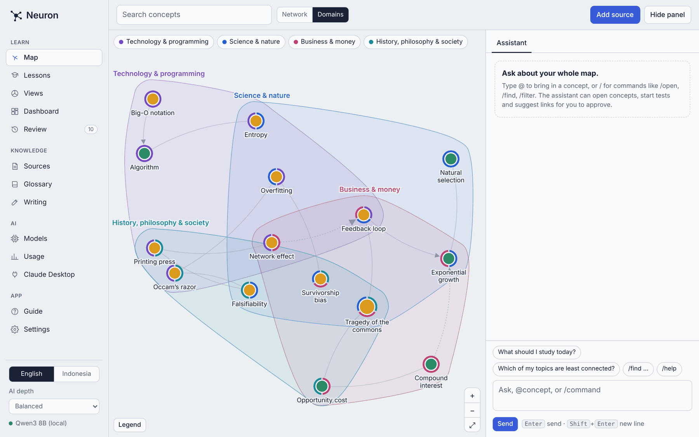
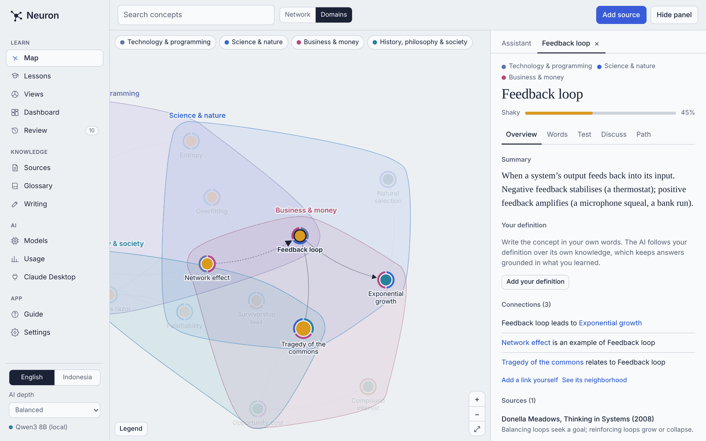
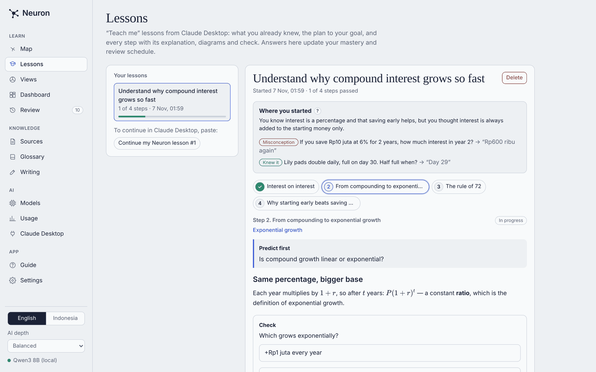
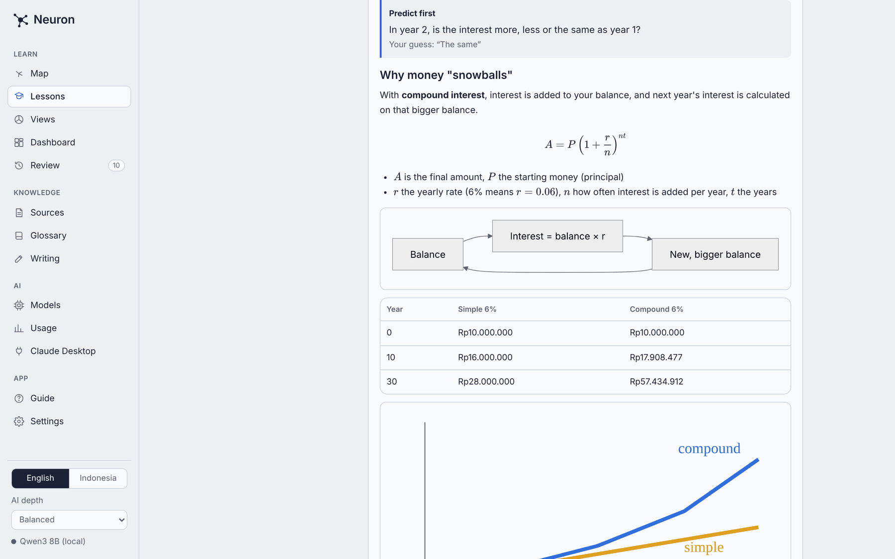
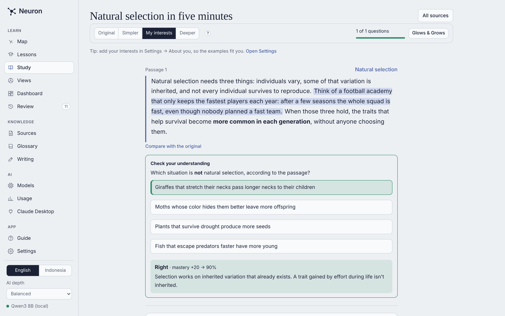
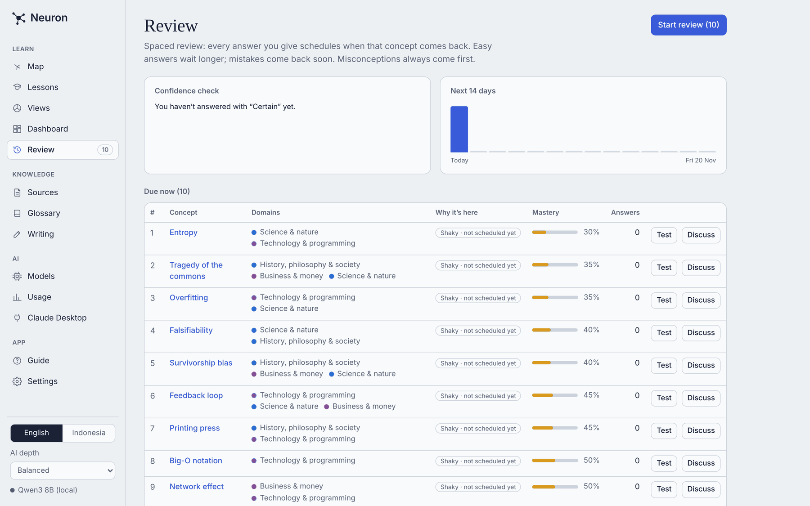
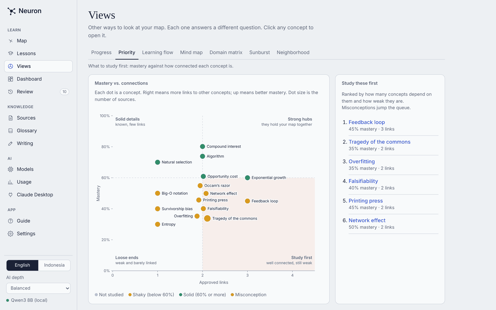
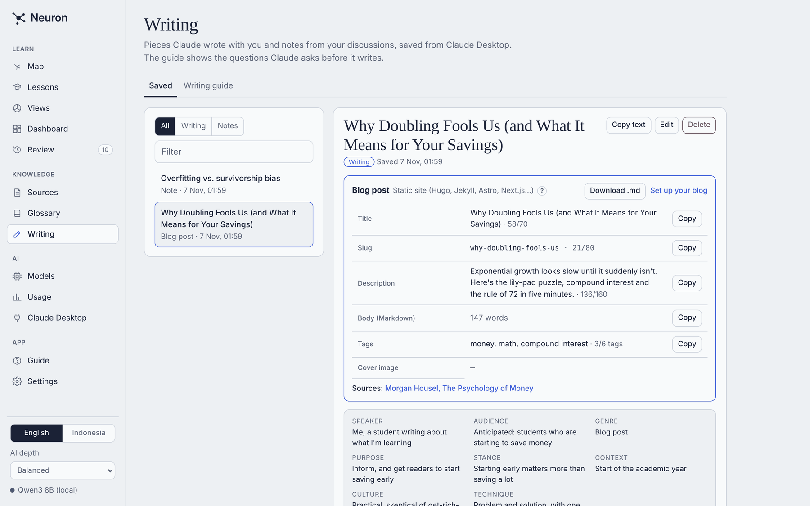
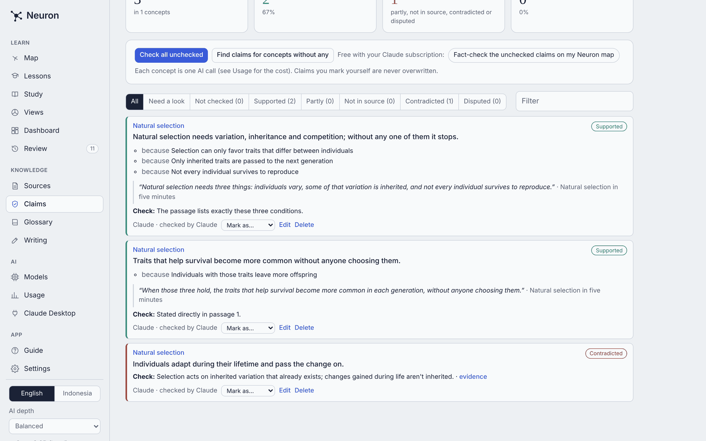
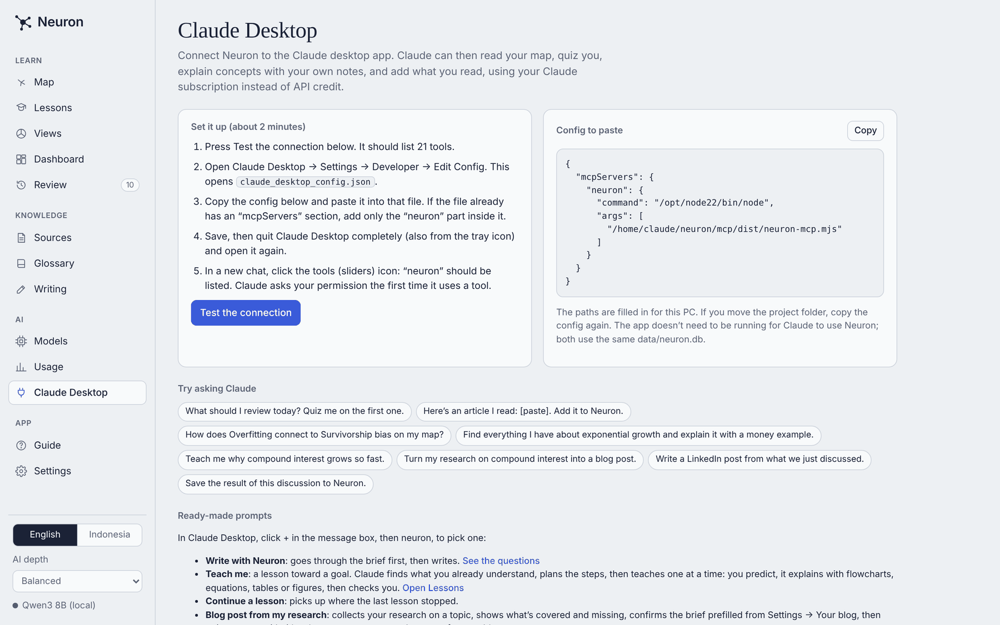

# Neuron

A personal learning app. Add sources (articles, notes, transcripts), and Neuron breaks each one into concepts and connects them across topics as a graph. Then it helps you understand and remember them with bilingual (English and Indonesian) tests, discussion and review. A concept seen in two sources is one node, and that shared node is what links topics together.

Built with Next.js, TypeScript, SQLite (better-sqlite3 + Drizzle) and d3. Runs locally (built and tested on Windows; macOS and Linux should work the same with Bun and Node).



## How it works

**1. Add what you read, and it becomes a map.** Paste an article or your notes, or upload a PDF, Word file or web page. The AI picks out the key concepts, quotes the passage each one comes from, and suggests links between them. A concept that appears in two sources becomes one node, and that shared node is what connects your topics. Each node is colored by how well you know it (gray: not studied, amber: shaky, green: solid); the ring shows its topics.



**2. Open any concept** to see its summary, write your own definition (the AI treats it as the source of truth), follow its connections and sources, learn its terms in English and Indonesian, take a test, or discuss it with the AI.

**3. Learn with “Teach me” lessons.** In Claude Desktop, ask “Teach me …”. Claude first asks a few questions to find what you already understand and what you’ve misunderstood. It then plans the steps to your goal from your map and teaches one step at a time: you predict, it explains, and it checks you. Everything is saved in **Lessons**.



Explanations use whatever makes the idea clearest: equations, flowcharts, tables and drawn figures.



**4. Or study a source directly.** **Study** turns any source into an active reader: a question after each passage, and buttons to switch a passage to a simpler version, one with examples from your interests (changed sentences highlighted), or a deeper one. Your answers update mastery, and the end shows **Glows** (what you did well) and **Grows** (what to re-read, with a ready "Teach me" prompt). Questions and versions can be written by the app's AI, or for free by Claude Desktop ("Prepare my source … for study").



**5. Remember it with spaced review.** Each answer (with how sure you were) updates your mastery and schedules the next review. Confident wrong answers are flagged as misconceptions and come back first.



**6. See the big picture.** **Views** answers different questions about your map. Priority shows which weak concepts hold the most together; there are also progress over time, a learning flow, a mind map, a domain matrix, a sunburst and a neighborhood view.



**7. Turn your research into writing.** Before Claude writes anything, it asks you a short brief based on the rhetorical situation: who is speaking, the audience, genre, purpose, stance, context and culture. Blog posts come with the fields your platform needs (title, slug, summary, tags) and a .md download. Notes from your discussions are saved here too.



**8. Check what your sources really say.** Each concept can hold its key **claims**, each with the reasons ("because …") and the sentence it comes from. A fact-check compares every claim with its passage, your own definitions and your glossary, and marks it supported, partly, not in source, contradicted or disputed. Lessons, blog posts and Claude use the supported claims as ground truth. **Claims** lists them all, with bulk checking.



**9. Take your notes anywhere.** Settings → **Export as Markdown notes** downloads your whole map as linked notes: one per concept (summary, your definition, claims, `[[connections]]`, terms, sources, practice questions), topic, source, lesson and piece of writing. Open the folder in Obsidian or any Markdown editor.

**10. Use it from Claude Desktop.** Neuron includes an MCP server. Claude can read and search your map, quiz you and record results, teach lessons, add sources and save writing, using your Claude subscription instead of API credit.



## Start it

You need **Bun** (https://bun.sh) to install and run scripts, and **Node.js 22 or newer** (https://nodejs.org) installed too: `bun run dev` starts Next.js, which runs on Node, and the SQLite driver is a Node add-on. Bun is the package manager and script runner; you never need to type `npm`.

**Easiest:** double-click `start-neuron.cmd`. The first run runs `bun install`, then the app opens at http://localhost:3000. Keep the window open while you use it.

**Or in PowerShell**, inside this folder:

```powershell
bun install
copy .env.example .env.local   # optional: put API keys here
bun run dev
```

Then open http://localhost:3000.

The database is created at `data\neuron.db` on first start, with a 15-concept demo map across four topics (technology, science, money, history and philosophy). It survives restarts.

## First steps

1. **Settings → About you**: your name, background and interests. The AI uses them for examples and explanations that fit you. Optional, but it makes a big difference.
2. **Settings → Your blog** (only if you blog): pick your platform (any Markdown blog, WordPress, Ghost, Medium, Substack, a static site like Hugo/Jekyll/Astro, or custom). It sets the field limits and format rules Claude follows when it turns your research into a post.
3. **Models**: connect an AI (below), or connect Claude Desktop (menu **Claude Desktop**) to use your Claude subscription.
4. **Settings → Start with an empty map** when you're ready to replace the demo with your own sources.

## Connect an AI model

Open **Models** in the sidebar.

1. **Providers and keys**: paste a key for the provider you want. Keys are saved in `data\neuron.db` (never in exports). You can also put them in `.env.local` instead.
   - Anthropic API: `ANTHROPIC_API_KEY`. A Claude.ai subscription does not include API access; the API is billed separately.
   - OpenRouter: `OPENROUTER_API_KEY`. Has free models; tick "Free models only" when browsing.
   - Google Gemini: `GEMINI_API_KEY`. Has a free tier.
   - Ollama: free and local, no key needed. Install and open the Ollama app, then download a model on the Ollama card (Models > Providers and keys > Download a model), or run `ollama pull qwen3:8b` in PowerShell. Use `pull`, not `ollama create`: `create` builds a custom model from a Modelfile.
   - OpenAI-compatible: any other API that speaks the OpenAI chat format (OpenAI, Groq, DeepSeek, LM Studio…).
2. **All models**: add models by name, or click a provider's name to browse the models it offers and add them in one click. Enter prices (USD per 1M tokens) so Usage can estimate cost.
3. **Models in use**: choose the model for each AI depth (Quick, Balanced, Deep reasoning) and press **Test model**.

Pick the current depth in the sidebar.

## The menu

| Menu | What it's for |
|---|---|
| **Guide** | Plain-language docs for Models (provider vs. key vs. model vs. depth, every box explained, costs, fixes) plus guided tours of Models and of the whole app |
| **Map** | The graph plus a right-hand column: the **Assistant** (chat over the whole map; `@` to mention a concept, `/` for commands such as `/open`, `/find`, `/filter`, `/review`) and the concept panel (Overview, Words, Test, Discuss, Path). “Hide panel” gives the graph full width |
| **Lessons** | “Teach me” lessons run by Claude Desktop: what you already knew (the probe), the step plan to your goal, and every step with its prediction, explanation (Markdown with Mermaid flowcharts, KaTeX equations, SVG figures, tables) and check. Answer checks here; results update mastery and review |
| **Study** | Read a source passage by passage with a question after each one; switch passages to simpler, interest-based or deeper versions; Glows & Grows feedback at the end |
| **Views** | Seven other ways to read the map: Progress (mastery over time, answers per day, most improved, slipping), Priority, Learning flow (copy as Mermaid), Mind map (from part of / example of), Domain matrix, Sunburst, Neighborhood |
| **Dashboard** | Mastery, confidence check, mastery by domain, domain overlaps, cross-domain links, recent answers |
| **Review** | Spaced review (FSRS): what's due now, what's coming in the next 14 days, misconceptions first |
| **Sources** | Paste text, upload PDF / Word / .txt / .md / subtitles, or import a web page. Long documents are read in parts; each concept quotes and links to its passage |
| **Claims** | The key claims under each concept with their reasons and quotes, fact-checked against the source, your definitions and glossary; filter by status and check in bulk |
| **Glossary** | Terms you taught the AI, plus your own concept definitions |
| **Writing** | Pieces Claude Desktop wrote with you (with their rhetorical brief) and notes saved from your discussions. Blog posts get a panel with each field of your blog's admin form (title, slug, summary, body, tags, cover) and a copy button; plus the writing guide: the questions Claude asks before writing and 21 writing techniques |
| **Models** | Which model does what, all your models, providers and keys |
| **Claude Desktop** | Connect the Claude desktop app through MCP: copy-paste config with your paths, a test button, the tools Claude gets and eight ready-made prompts (Teach me, Continue a lesson, Prepare a source for study, Fact-check my map, Write with Neuron, Blog post from my research, Save this discussion, Read a text critically) |
| **Usage** | Every AI call: cost, tokens, speed, by day, model and feature; monthly budget with optional hard stop |
| **Settings** | About you (name, background, interests: every AI prompt uses them for examples), Your blog (name, address, readers, voice, format rules for the research-to-post flow), language, map view, AI depth, theme, backups, export, empty map or reset to demo |

## How it stays accurate

- Your definition on a concept and every glossary term go into every AI prompt as the source of truth. If the model's knowledge conflicts, it follows yours and says so.
- When the AI meets a term it isn't sure about, it lists it, and the app asks you to define it. The answer is saved to the glossary.
- AI-suggested links stay blue and dashed until you approve them.

## Scoring

- Multiple choice uses confidence-based marking. Right: +6 / +14 / +20 (guessing / fairly sure / certain). Wrong: 0 / −8 / −18. Certain and wrong flags a misconception; certain and right clears it. Bridge questions give +5 extra and +5 to the linked concept.
- Essays: mastery change = ((score − 50) / 50 × 20) × confidence multiplier (gains 0.5 / 0.85 / 1.1, losses 0.3 / 0.8 / 1.3).

## Scripts

| Command | What it does |
|---|---|
| `bun run dev` | Start the app at http://localhost:3000 |
| `bun run seed` | Replace your map with the demo map (keeps models, keys and usage) |
| `bun run db:backup` | Save a dated copy of the database in `data\backups` |
| `bun run build` then `bun run start` | Faster production mode |
| `bun run typecheck` | Check TypeScript |
| `bun run mcp:build` | Rebuild the Claude Desktop server (`mcp/dist/neuron-mcp.mjs`) after changing code |
| `bun run mcp` | Start the MCP server by hand (Claude Desktop normally does this) |

## Project layout

```
app/                 pages (one folder per menu) and API routes (app/api)
components/          React components; graph/GraphView.ts is the d3 port
lib/db/              SQLite schema (Drizzle), connection, seed
lib/ai/              provider layer (generate.ts), prompts, model catalog, usage
lib/repo.ts          all reads and writes of the knowledge map
lib/logic.ts         scoring and learning-path rules, shared by server and client
lib/seed-data.ts     the demo map from the prototype
data/neuron.db       your data (git-ignored)
```

## Troubleshooting

- **SQLite error on start (better-sqlite3)**: the package ships a ready-made Windows build, so nothing is compiled. If it still fails, check `node -v` is 22 or newer, delete `node_modules`, and run `bun install` again.
- **Don't run with `bun --bun`**: that forces the Bun runtime, which can't load the SQLite driver. Plain `bun run dev` is correct.
- **`bun install` says it blocked a postinstall (esbuild)**: that's expected and harmless.
- **Port 3000 is busy**: run `bunx next dev -p 3001`.
- **"No model is set for this AI depth"**: open Models > Models in use and pick one.
- **"Ollama hasn't downloaded this model yet"**: the model name is in your list but not on your PC. Click Download on the Ollama card, or run `ollama pull <name>`, then `ollama list` to check.
- **Ollama says it can't connect**: make sure the Ollama app is running, and the base URL in Models > Providers is `http://localhost:11434`.
- **Fonts look plain offline**: the UI fonts load from Google Fonts; without internet it falls back to system fonts.

## Roadmap

- **Phase 3** (done): file and web import with passage citations, FSRS review, backups, and embeddings (Models → Search index) for search by meaning, smarter merging and grounded Assistant answers. Vectors are stored in SQLite and compared in plain JavaScript, fast enough for thousands of items.
- **Phase 4** (done): MCP server for Claude Desktop (`mcp/server.ts`, 26 tools and 8 prompts, no extra packages), with a rhetorical-situation writing brief and saved discussion notes, Progress and Mind map views. 
- **Phase 5** (done): “Teach me” lessons (probe → plan → predict, explain, check), rich lesson content (Mermaid, KaTeX, SVG, tables). 
- **Phase 6** (done): Study a source: questions inside the reader, simpler / interest / deeper versions, Glows & Grows feedback.
- **Phase 7** (done): claims with reasons and quotes under each concept, fact-checking (in-app AI or Claude Desktop), and a Markdown (Obsidian) export.
- Ideas: import an Obsidian folder, export to Anki, a better phone layout.
